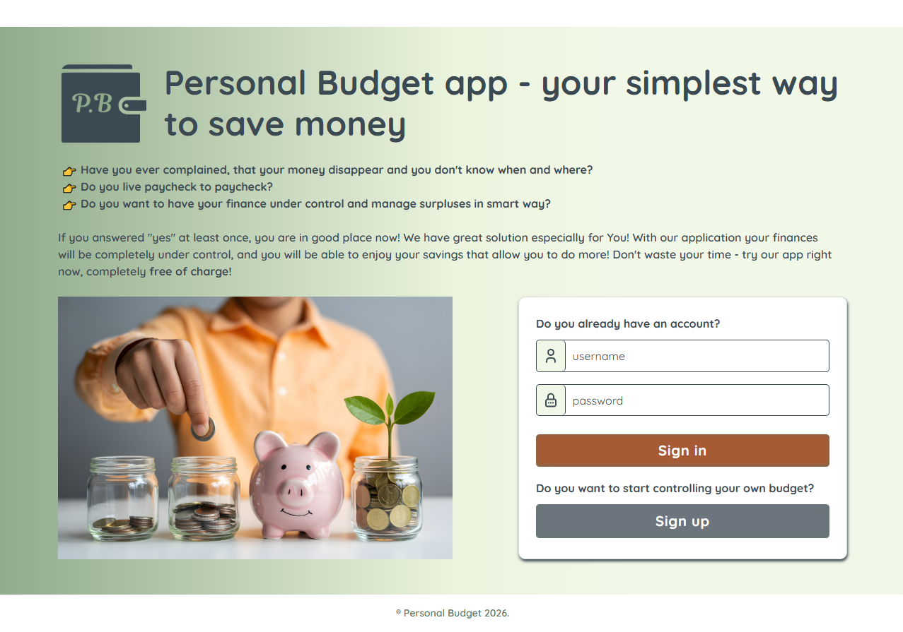
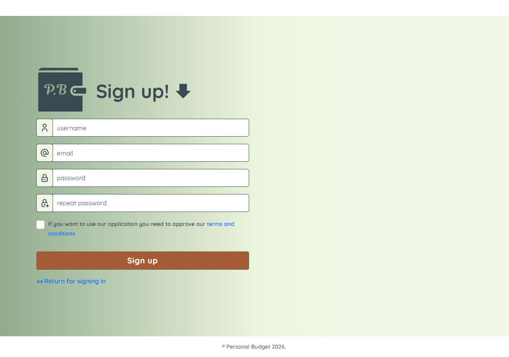
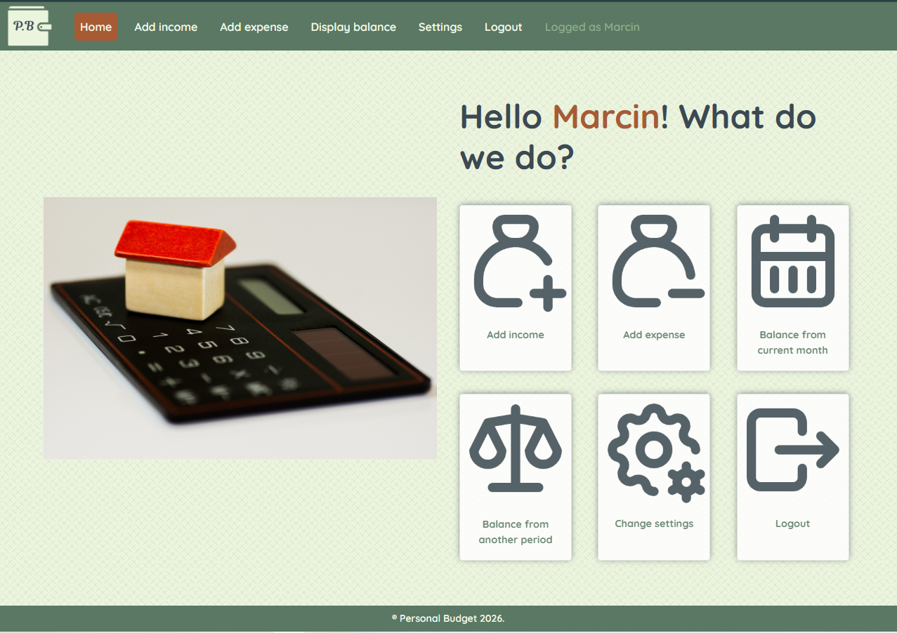

# Personal Budget Webpage

## Overview

Personal budget web application - application, which helps in personal financial managment. It enables adding incomes and expenses. The user can see balance from selected period: current month, previous month, current year or non-standard period - the last one enabables to change required range of dates by user.
The application is here: https://budget.lukasz-nowak.profesjonalnyprogramista.pl.profesjonalnyprogramista.pl/index.php

## Built with

- Semantic HTML5 markup
- CSS custom properties
- Bootstrap 5
- PHP

## Screenshot

## App Development Phase

At this moment avilable are these functions:

- registration and log in after veryfication
- adding incomes and expenses into personal account
- checking balance from periods: last month, previous month, last year and non-standard period. The last one enables to select start and end date by user
- balance shows the difference between the sum of incomes and expenses and tables with incomes and expenses divided by categories
- after clicking on details the user can see in details all incomes and expenses for each category
- chart shows the percent of each expense's category from total expenses amount

In the future the next options will be added such as changing password or incomes and expenses edition. 

## Important Information - Temporary Solution

The look of "settings" subsite is under construction.

## Author

- Github - [Łukasz Nowak](https://github.com/lukasz-nowak44)
